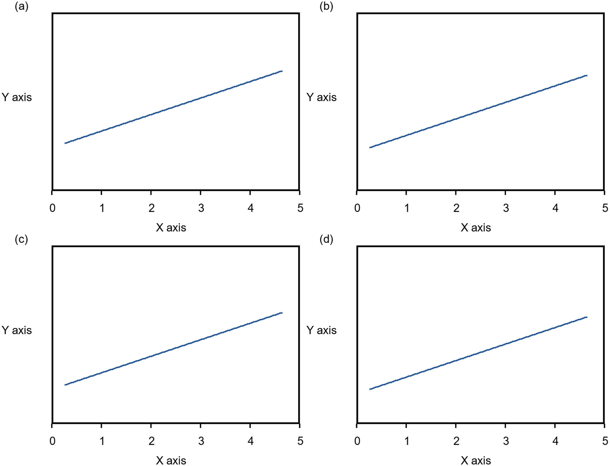

# FigureBridge — Origin–Word 科研图表自动化工作流与 Skills

[](https://github.com/Ho-boop/figurebridge/actions/workflows/tests.yml)

An independently developed set of assistant skills and executable scripts for source-panel preflight, figure layout, and document delivery. It deals with visual consistency and publishing geometry; it does not perform the spectral/device calculations in LUEFlow.



The preview above uses generated drawing fixtures and the same scale for all four panels.

## Concrete capabilities

- **Origin format skill:** role-specific fonts and sizes, line-width units, dynamic font initialization, preserved sample identity, saved-project reopening, and EMF export inspection.
- **Panel preflight:** normalized previews and contact sheets, content bounds, plot frames, edge-clipping warnings, and source hashes.
- **Word composition:** one common panel scale, plot-frame alignment, mask-based collision constraints, protected built-in a/b/c labels, and retained EMF media.
- **Delivery inspection:** analysis JSON and previews; an optional Microsoft Word COM script exports the final DOCX to PDF.
- **Competition plotting skill:** data provenance, paired comparison rules, outlier preservation, symlog scatter and distribution layouts. This component is a skill specification, not a separate plotting application.

## Run the synthetic raster demo

Python 3.10+:

```bash
git clone https://github.com/Ho-boop/figurebridge.git FigureBridge
cd FigureBridge
python -m pip install -r requirements-dev.txt
python examples/generate_panels.py
python skills/origin-word-figure-layout/scripts/preflight_origin_panels.py --input-dir examples/panels --cols 2 --qa-dir outputs/preflight
python skills/origin-word-figure-layout/scripts/compose_origin_word_figure.py --input-dir examples/panels --output outputs/demo.docx --cols 2 --qa-dir outputs/layout
python -m pytest tests -q
```

Inspect `outputs/preflight/preflight-contact-sheet.png` before composing; inspect `outputs/layout/layout-preview.png` afterward. This synthetic preview is not a substitute for rendering the DOCX in Word. Source images are generated drawing fixtures, with no laboratory data. The CLI works directly without a Codex installation.

## Windows EMF and native applications

EMF previews require Windows PowerShell and System.Drawing. Final Word-to-PDF export requires Microsoft Word and its COM interface:

```powershell
powershell -NoProfile -File skills/origin-word-figure-layout/scripts/export_docx_pdf_word.ps1 -InputDocx outputs/demo.docx -OutputPdf outputs/demo.pdf
```

Origin formatting requires an installed, licensed Origin application. `origin-figure-style` is documented assistant guidance, with LabTalk/COM examples; it is not a one-click Origin batch application. Exact behavior must be validated on the installed version. Third-party applications and document skills are not included.

## Install as assistant skills

Copy individual directories from `skills/` to the skill directory supported by your assistant. Each has a `SKILL.md`; the layout skill's scripts must stay beside it. Override default typography and colors with project requirements. The public version removes research-specific sample-color mappings.

## Verification limits

Automated checks validate layout geometry, clipping detection, common scale, DOCX anchors/media, and unchanged source hashes on synthetic raster panels. Typography consistency still requires visual inspection. Native Origin and Word automation need a Windows machine with those applications. See [AI_WORKFLOW.md](AI_WORKFLOW.md).
